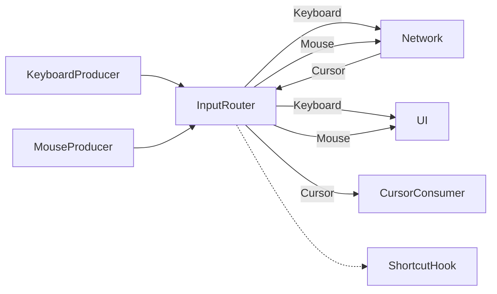
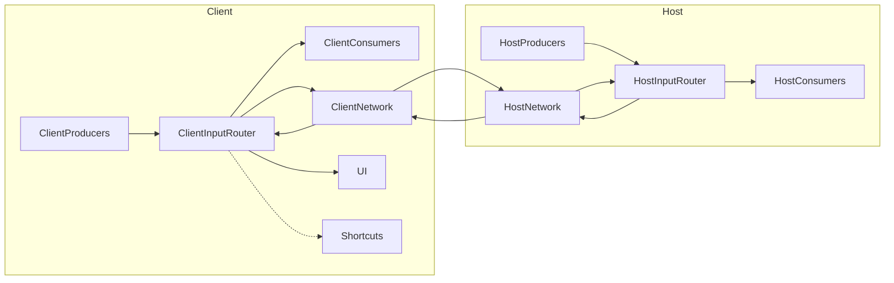

# Definitions

## Host/Client

* Host: Machine that is remotely accessed by a user
* Client: Machine that is remotely accessing a Host
* Guest: A Host owner can allow another user to view and/or control its Host. This user is called a Guest

## Input

An Input represents an action from a user (key press, mouse move, file, ...). The lifecycle of an Input\` is:

* Acquisition. Here the Input is _produced_
* Send Input over the network, to the Host or the Client
* Injection. Here the Input is _consumed_

## InputType

Because Inputs can be generated from several sources (keyboard, mouse, gamepad, ...), they are splitted into several types:

* `Keyboard`: Key press/release
* `MouseButton`: Mouse button press/release
* `MouseWheel`: Mouse wheel move
* `MouseMove`: Relative mouse move. This is a delta between the previous position and the current one, on X and Y axis
* `MousePosition`: Absolute mouse move. This is the position (X, Y) of the mouse cursor in the Host screen
* `Gamepad`: Key press/release, Stick move, Rumble
* `Cursor`: The shape (a bitmap) of the cursor
* `Clipboard`: A string that the user wants to copy/paste
* `File`: A file that the user wants to copy/paste

Those types share some size/frequencies properties

* Small size (few bytes) and High frequency types (can be sent multiple time every second)
  * `Keyboard`
  * `MouseButton`
  * `MouseWheel`
  * `MouseMove`
  * `MousePosition`
  * `Gamepad`
* Large size (many kilobytes) and Low Frequency
  * `Cursor`
  * `Clipboard`
  * `File`

## InputPacket

Generic type that can represent any InputType with its associated data. Because it is a generic type, it can be forwarded/filtered/duplicated by generic blocs over the input pipeline.

An InputPacket contains

* Attributes
  * `InputType`
  * `Data`: The required data to represent the Input. There is one specific type of Data for each InputType
  * To be confirmed
    * `SequenceId`
* Methods
  * `Serialize()`
  * `Deserialize()`
  * `Clone()`
  * `Copy()`

## InputPacketHandler

A component that can produce and/or consume some Inputs of one or more InputType. Depending of the OS requirements, the Client and the Host will create a list of InputPacketHandler to handle as many InputType as possible.

Note that if many physical/virtual devices can provide a specific InputType (example: you can plug multiple gamepads on a Client), only one InputPacketHandler will be created. This single instance will manage a list of devices, and will produce/consume data with a DeviceId to identify the device.

An InputPacketHandler can run its own thread or spawn a Tokio task if possible. When an InputPacketHandler is a Consumer, it has to manage itself the inter-thread communication.

Each InputPacketHandler will also provide an API to allow the other components to request some specific actions, or get some notifications.

Example of possible APIs

* GamepadPacketHandler
  * Notifications
    * GamepadPlugged
    * GamepadUnplugged
* FilePacketHandler
  * Method
    * SendFile
    * CancelSend
  * Notifications
    * IncomingFileTransferStarted
    * ProgressionUpdate

## InputRouter

On both Client and Host side, there will be many Producer and Consumer. The Input produced by one Producer can be consumed by many Consumers. The list of targeted Consumers can vary over application lifetime.

For example:

* If the focus of the window is lost, no key press should be sent to the Host
* If the UI is opened, no Input should be sent to the Host
* If a user is allowed to control a second Host as a Guest, its Inputs can be either sent to one Host or the other

Every Producer has a reference to InputRouter, to send Events when required. The Event send API is thread safe to allow InputPacketHandler to send Events from any thread.

Consumers register to InputRouter to get Inputs of a specific InputType.

The InputRouter goal is to apply some routing policy to send the incoming Inputs to the correct list of Consumers.

It can also get a Hook plugged to take some action before the Inputs are sent to the Consumers. This will be mainly used to implement some shortcuts that can decide to drop the Input or change the routing policy. When switching to Fullscreen, the shortcut isn't forwarded to the Host as it is a local shortcut. When the UI is opened, the Inputs aren't forwarded to the Host.

Special note about network layer: the network part is a consumer and a producer. It will consume the Inputs generated by local Producers when allowed, and it will forward Inputs generated by remote Producers.



# Client vs Host implementation

Client and Host will share the same InputRouter and Network layer. That's it.

For each InputType, there will be two implementations of InputPacketHandler, one used by the Client and the other by the Host. Those two components will be able to send InputPacket to each other through the InputRouter and the Network layer.

Every InputType will implement its own communication protocol over InputPacket, to represent its custom Inputs and Control requests.

# Global overview



# 12/12/2024 : Packet serialization/deserialization over kycom and kyproto

## libkynput

An `InputPacket` can be `.serialize()` and `deserialize()`. This produces an opaque buffer that only libkynput understand.

```rust
impl InputType {
    pub const fn from_u8(t: u8) -> Option<Self>;
}

impl InputPacket {
    pub fn get_type(&self) -> InputType;

    pub fn serialize(&self) -> Vec<u8>;

    pub fn deserialize(type_: u8, target: InputTarget, buf: &[u8]) -> Result<Self>;
}
```

## libkynput kycom and TCP backend

### Serialize (pseudocode)

```rust
fn send_packet(s: TcpStream, pkt: InputPacket) {
    let type_: u8 = pkt.get_type() as u8;
    let payload: Bytes = pkt.serialize();
    let size: u16 = payload.size();

    let network_pkt: Bytes = concat(type_, size, payload);
    s.write_all(network_pkt);
}
```

### Deserialize (pseudocode)

```rust
fn recv_packet(s: TcpStream) -> InputPacket {
    let type_: u8 = s.read(1);
    let size: u16 = s.read(2);
    let payload: Bytes = s.read(size);

    InputPacket::deserialize(type_, payload)
}
```

## kycom InputPacket format

```
------------------------------------------
| type (u8) | size (u16) | payload(size) |
------------------------------------------
```

## `InputKyPacket`

```rust
pub struct InputPacket {
    pub type_: u8,
    pub payload: Bytes,
}
```

## kyproto `InputKyPacket` format

```
------------------------------------------
| type (u8) | size (u16) | payload(size) |
------------------------------------------
```

